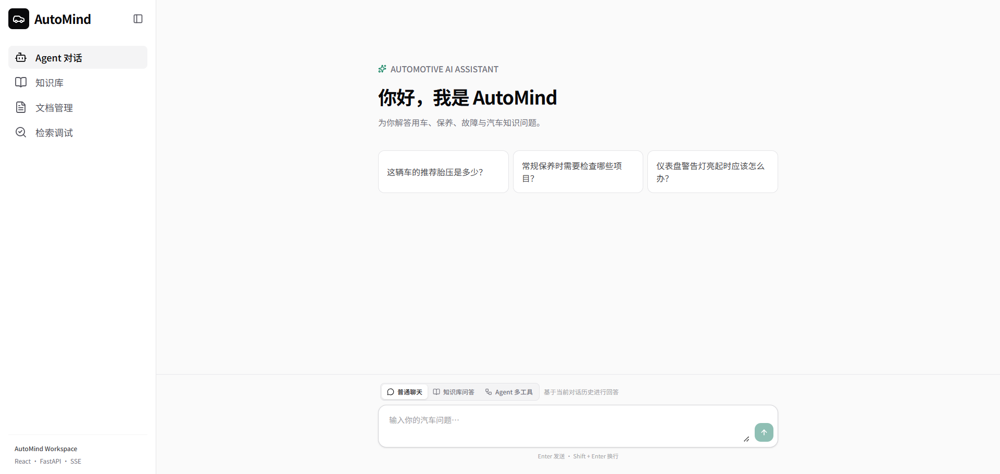
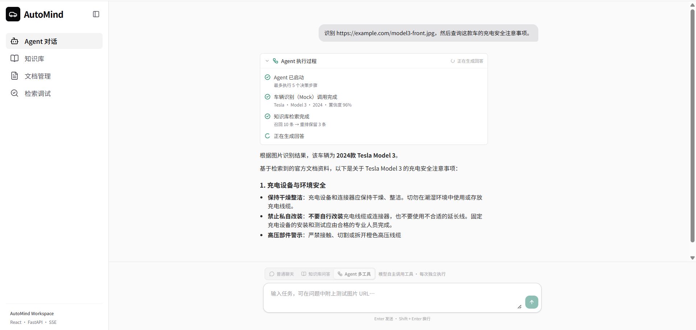
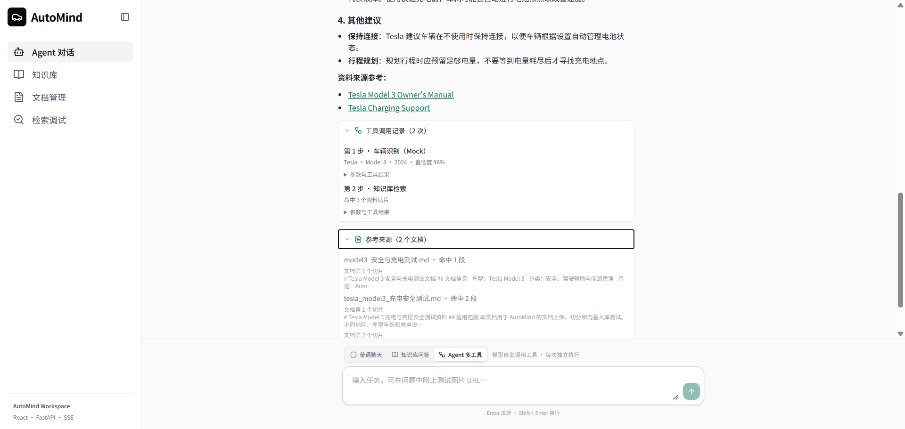
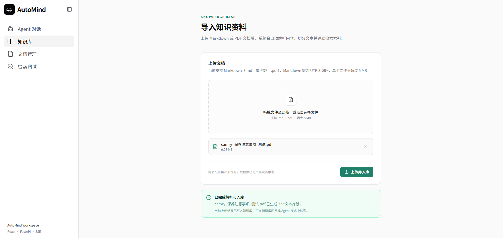
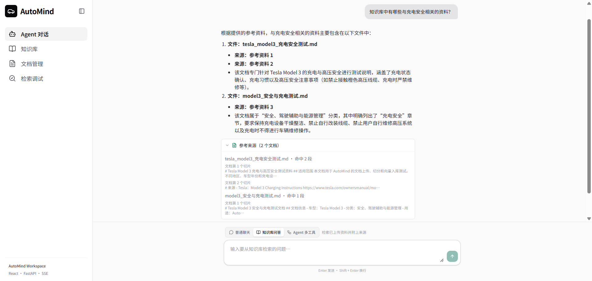
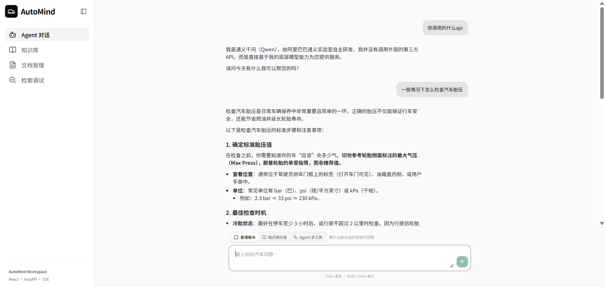
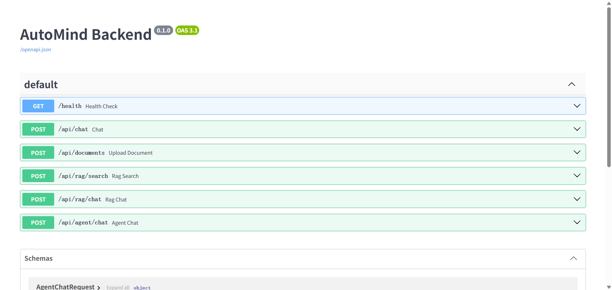

# AutoMind

AutoMind 是一个面向汽车知识场景的智能助手项目，完整串联了文档入库、RAG 检索、流式问答和手写 ReAct Agent。项目不依赖 LangChain 高层 Agent，而是自行实现工具注册、结构化决策、工具执行、结果观察、重试和 SSE 事件流。

当前项目支持：

- 上传 Markdown、PDF 汽车资料并写入 PostgreSQL + pgvector；
- 向量检索 Top-K，并通过千问 Reranker 二次排序；
- 基于知识库生成带参考来源的流式回答；
- 由模型自主选择 `vehicle_recognize`、`rag_search` 工具；
- 在前端实时展示 Agent 执行过程、工具记录、正文和参考来源；
- 通过 Docker Compose 启动前端、后端和数据库。

> `vehicle_recognize` 当前是用于验证 Tool Contract 和 Agent 调度的 Mock，不是真实计算机视觉模型。

## 项目展示

### 首页



### ReAct Agent 多工具调用

模型根据用户任务自主调用车辆识别和知识库检索工具，前端实时展示执行阶段、工具结果和最终回答。





### RAG 知识库

<table>
  <tr>
    <td width="50%"></td>
    <td width="50%"></td>
  </tr>
  <tr>
    <td align="center">文档上传、解析与向量入库</td>
    <td align="center">带参考来源的 RAG 问答</td>
  </tr>
</table>

### 普通对话与后端接口

<table>
  <tr>
    <td width="50%"></td>
    <td width="50%"></td>
  </tr>
  <tr>
    <td align="center">普通多轮流式对话</td>
    <td align="center">FastAPI 接口文档</td>
  </tr>
</table>

## 项目架构

```text
Browser
  │
  ▼
React + TypeScript + Nginx
  │ HTTP / SSE
  ▼
FastAPI
  ├── 普通聊天 ───────────────► Qwen LLM
  ├── 文档入库 ─► Parse ─► Chunk ─► Embedding ─► pgvector
  ├── RAG 问答 ─► Retrieval ─► Reranker ─► Prompt ─► Qwen LLM
  └── ReAct Agent
        ├── vehicle_recognize（Mock）
        └── rag_search ─────────────► RAG Pipeline
```

### RAG Pipeline

```text
Markdown / PDF
  → Parse（保留 source、page）
  → Chunk（约 800 字符，重叠 150 字符）
  → Embedding
  → PostgreSQL + pgvector

Question
  → Query Embedding
  → Vector Search Top 10
  → Qwen Reranker Top 3
  → Context + Question
  → Qwen LLM
  → SSE Answer + Sources
```

### Agent Loop

```text
User Request
  → LLM Structured Decision
  → Tool Call
  → Observation
  → LLM Next Decision
  → Final Answer
```

Agent 最多执行 5 个决策步骤，并包含非法 JSON 重试、未知工具纠正、参数校验、重复调用拦截和超限兜底。

## 技术栈

| 模块 | 技术 |
| --- | --- |
| 前端 | React 19、TypeScript、Vite、React Router、Tailwind CSS |
| 后端 | Python 3.11、FastAPI、Pydantic、SQLAlchemy |
| 模型 | 阿里云百炼千问 OpenAI-Compatible API |
| RAG | Qwen Embedding、Qwen Reranker、pgvector |
| 数据库 | PostgreSQL 16 + pgvector |
| 流式传输 | Server-Sent Events（SSE） |
| 部署 | Docker、Docker Compose、Nginx |

## Docker 快速启动

### 1. 环境要求

- Git
- Docker Desktop（需启用 Docker Compose）
- 一个可用的阿里云百炼 API Key

使用 Docker 时，不需要在宿主机单独安装 Python、Node.js 或 PostgreSQL。

### 2. 克隆与配置

```bash
git clone git@github.com:daisi3/automind.git
cd automind
```

Windows PowerShell：

```powershell
Copy-Item .env.example .env
```

macOS / Linux：

```bash
cp .env.example .env
```

打开根目录 `.env`，至少填写：

```env
LLM_API_KEY=你的阿里云百炼_API_Key
```

`.env` 已被 Git 忽略，不要提交真实密钥。

### 3. 启动

```bash
docker compose up -d --build
```

| 服务 | 地址 |
| --- | --- |
| AutoMind 前端 | <http://127.0.0.1:3000> |
| FastAPI 文档 | <http://127.0.0.1:8000/docs> |
| 后端健康检查 | <http://127.0.0.1:8000/health> |
| PostgreSQL | `127.0.0.1:5432` |

常用命令：

```bash
docker compose ps
docker compose logs -f frontend backend postgres
docker compose down
```

PostgreSQL 数据保存在 Docker 命名卷 `automind-postgres-data` 中。普通的 `docker compose down` 不会删除数据；只有显式执行 `docker compose down -v` 才会删除命名卷。

## 环境变量

| 变量 | 作用 | 默认值 |
| --- | --- | --- |
| `LLM_API_KEY` | 千问、Embedding、Reranker 共用的 API Key | 必填 |
| `LLM_BASE_URL` | OpenAI-Compatible API 地址 | 阿里云百炼兼容地址 |
| `LLM_MODEL` | 聊天与 Agent 决策模型 | `qwen3.7-flash` |
| `LLM_ENABLE_THINKING` | 是否开启模型思考模式 | `false` |
| `EMBEDDING_MODEL` | 文本向量模型 | `text-embedding-v4` |
| `RERANK_MODEL` | 检索重排模型 | `qwen3-rerank` |
| `RERANK_BASE_URL` | Reranker API 地址 | 阿里云百炼重排地址 |
| `POSTGRES_PASSWORD` | PostgreSQL 密码 | `automind_dev_password` |
| `DATABASE_URL` | 非 Docker 本地开发数据库连接 | 指向 `127.0.0.1:5432` |
| `VITE_API_BASE_URL` | 浏览器访问的后端地址 | `http://localhost:8000` |

Compose 会把后端数据库主机自动改为服务名 `postgres`，无需手动修改 `DATABASE_URL`。

## 使用演示

### 导入知识文档

打开 <http://127.0.0.1:3000/knowledge>，上传不超过 5 MB 的 `.md` 或 `.pdf` 文件。后端会执行：

```text
Upload → Parse → Chunk → Embedding → Store
```

### 知识库问答

进入聊天页面，切换到知识库问答模式，例如提问：

```text
这份资料中有哪些保养注意事项？
```

页面会流式显示回答，并在正文下方展示命中的文件、页码或切片摘要。

### Agent 多工具调用

切换到 Agent 模式，输入：

```text
请识别 https://example.com/camry-front.jpg 中的车辆，然后查询这款车的保养注意事项。
```

预期过程：

```text
vehicle_recognize
  → Toyota Camry 2024
  → rag_search
  → Vector Retrieval + Reranker
  → Final Answer
```

Mock 车辆识别支持 URL 关键词：`camry`、`model3`、`model-3`、`accord`。

## API

| 方法 | 路径 | 作用 | 响应 |
| --- | --- | --- | --- |
| `GET` | `/health` | 后端健康检查 | JSON |
| `POST` | `/api/chat` | 普通多轮聊天 | SSE |
| `POST` | `/api/documents` | 上传 Markdown/PDF 并入库 | JSON |
| `POST` | `/api/rag/search` | 调试向量检索或重排结果 | JSON |
| `POST` | `/api/rag/chat` | 单轮 RAG 问答 | SSE |
| `POST` | `/api/agent/chat` | ReAct Agent 多工具执行 | SSE |

请求示例：

`POST /api/chat`

```json
{
  "messages": [{ "role": "user", "content": "你好" }]
}
```

`POST /api/rag/search`

```json
{
  "query": "Camry 有哪些保养注意事项？",
  "limit": 3,
  "rerank": true
}
```

`rerank: false` 只执行向量检索；`rerank: true` 会先取向量 Top 10，再返回重排后的指定数量结果。

`POST /api/rag/chat`

```json
{
  "question": "Camry 有哪些保养注意事项？"
}
```

`POST /api/agent/chat`

```json
{
  "message": "识别 https://example.com/camry-front.jpg，然后查询这款车的保养注意事项。"
}
```

Agent SSE 可能包含 `agent_start`、`phase`、`tool_call`、`tool_result`、`retrieval`、`token`、`final`、`error`、`sources` 和 `[DONE]`。

## 本地开发

后端：

```powershell
python -m pip install -r backend/requirements.txt
cd backend/app
python -m db.init_db
python -m uvicorn main:app --reload --port 8000
```

前端：

```bash
cd frontend
npm ci
npm run dev
```

检查与测试：

```powershell
cd backend/app
python -m unittest discover -s ../tests -v
```

```bash
cd frontend
npm run lint
npm run build
```

## 目录结构

```text
automind/
├── backend/
│   ├── Dockerfile
│   ├── requirements.txt
│   ├── tests/
│   └── app/
│       ├── agent/              # ReAct 循环、决策模型和事件
│       ├── core/               # 环境配置
│       ├── db/                 # 数据模型、连接和初始化
│       ├── llm/                # Chat 与 Embedding 客户端
│       ├── rag/                # 解析、切片、入库、检索、重排和 Prompt
│       ├── tools/              # Tool 抽象、注册表和具体工具
│       └── main.py             # FastAPI 入口
├── frontend/
│   ├── Dockerfile
│   ├── nginx.conf
│   ├── FRONTEND_ARCHITECTURE.md
│   └── src/
│       ├── app/                # 路由
│       ├── components/         # 公共组件
│       ├── layouts/            # 应用布局
│       ├── pages/              # Chat、Knowledge 等页面
│       └── services/           # HTTP 与 SSE 封装
├── knowledge/                  # 本地测试知识资料
├── docker-compose.yml
├── .env.example
└── README.md
```

## 数据库

最小数据模型：

```text
documents: id, filename, created_at
chunks: id, document_id, content, embedding, metadata
```

进入数据库：

```bash
docker exec -it automind-postgres psql -U automind -d automind
```

```sql
SELECT COUNT(*) FROM documents;
SELECT COUNT(*) FROM chunks;
SELECT id, filename, created_at FROM documents ORDER BY id DESC;
```

## 当前限制

- RAG 和 Agent 当前都是单轮请求，不保存历史会话；
- 普通聊天上下文只保存在当前页面，刷新后丢失；
- `vehicle_recognize` 是根据 URL 关键词返回结果的 Mock；
- 尚未实现用户体系、权限、会话持久化和完整文档管理；
- 数据保存在本机 Docker 命名卷中，项目暂未提供云端数据库和自动备份；
- 当前面向本地演示，生产部署仍需 HTTPS、密钥管理和访问控制。

## 常见问题

### Docker 拉取镜像超时

中国大陆网络可能无法稳定访问 Docker Hub。请在 Docker Desktop 的 Docker Engine 配置中添加可用镜像源，并重启 Docker Desktop。

### 端口被占用

确保 `3000`、`8000`、`5432` 没有被其他进程占用，或修改 Compose 的宿主机端口。

### 模型接口提示未配置 API Key

确认根目录 `.env` 中存在有效的 `LLM_API_KEY`，然后重新创建服务：

```bash
docker compose up -d --force-recreate backend frontend
```

### 前端能打开，但请求后端失败

```bash
docker compose ps
docker compose logs backend
```

确认 <http://127.0.0.1:8000/health> 返回 `{"status":"ok"}`。

## 安全说明

- 不要把 `.env`、API Key、数据库密码或云平台密钥提交到 Git；
- 示例密码只适用于本地开发；
- 上传接口只接受 Markdown 和 PDF，单文件最大 5 MB；
- 对外部署前应更换数据库密码并增加鉴权、限流和 HTTPS。
